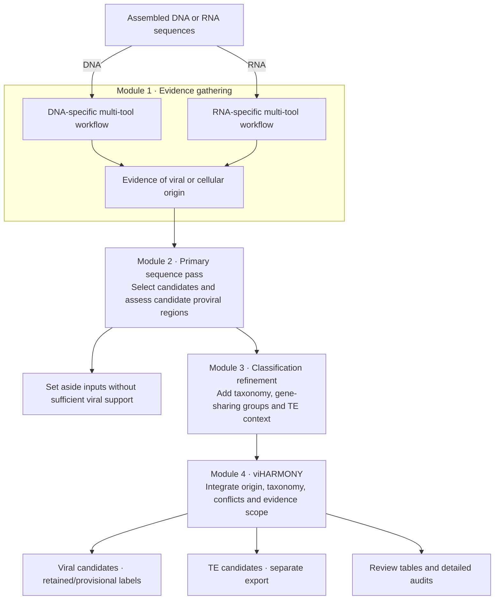

# viSUM

Viral discovery and standardized classification for assembled DNA and RNA sequences.

## Motivation

viSUM was developed to help my students, regardless of experience level, perform in-depth, comprehensive viral analyses of their high-throughput sequencing data. My goal was to make these analyses accessible for their thesis projects without requiring each student to build and integrate a complex computational workflow from scratch. I hope it proves useful to other students, educators, and researchers as well!

viSUM combines complementary programs to identify viral candidates and summarize
their origin, taxonomy, quality and conflicting evidence. viHARMONY integrates
those results into sequence-level calls, with the detailed evidence retained for
inspection. Support categories describe evidence, not calibrated probabilities.

Version `0.9.0-beta.2` is currently a **development candidate**, not a published
release. Use for research; it is not validated for clinical diagnosis.

## What's changed since beta.1

- **Simpler setup and resume.** Use ordinary Nextflow commands. Database
  preparation is separate from analysis; valid installed assets are reused.
- **Faster viHARMONY.** Bounded multiprocessing is available through
  `--harmonizer_cpus`; the default remains one worker.
- **Automatic viCAT source acquisition.** Setup can download the pinned MetaVR
  sources and the nonviral references selected by the packaged assembly list.
- **Consistent taxonomy names.** A pinned ICTV reconciliation bundle translates
  supported names for taxonomy voting while preserving the original evidence.
- **Family-default reporting.** `--harmonizer_max_rank family` limits reported
  depth; deeper predictions remain in the audits. A deeper cap permits, but
  does not create, a supported genus or species assignment.
- **Clearer viral and TE outputs.** Viral candidates have one combined FASTA
  with retained/provisional labels. TE candidates have a separate FASTA and
  summary. Review reasons are tables, not additional FASTA exports.
- **More accessible summaries.** Outputs include original/parent identifiers,
  CheckV assessment scope and completeness, vCONTACT3 group context, and `NA`
  placeholders for missing values.
- **Runtime and resource fixes.** TEsorter uses a short temporary path,
  vCONTACT3 includes Parquet support, viHARMONY requests 32 GB by default, and
  viSUM does not impose task wall-time limits.

Use a new work/results directory when moving from beta.1. Output filenames and
some TE destinations have changed; beta.1 results should not be silently mixed
with beta.2 results. See the [changelog](CHANGELOG.md).

## Get started

Use Linux with Java, Nextflow, Conda and Mamba on `PATH`. Clone the candidate
branch and prepare the default tools once:

```bash
git clone --branch dev/beta.2-release https://github.com/ViDaB-Lab/viSUM.git
cd viSUM
nextflow run visum_nextflow.nf --setup
```

Then analyze an assembled nucleotide FASTA:

```bash
nextflow run visum_nextflow.nf \
  --input /data/contigs.fasta --prefix sample01 --type dna \
  --outdir results/sample01
```

Use `--type rna` for assembled transcripts. Resume by repeating the analysis
command with `-resume` from its original launch directory. Keep `.nextflow/`
and the task work directory.

Databases default to `<installation>/databases`, tool/model bundles to
`<installation>/tools`, and Conda environments to `<installation>/.conda`.
You do not need to set those paths unless you want different locations.

viCAT is optional and off by default. To also prepare its viral and nonviral
databases:

```bash
nextflow run visum_nextflow.nf --setup --run_vicat true -profile vicat_build
```

The full viCAT viral build is large: its current allocation is **350 GB RAM**,
within the profile's 400-GB scheduling budget. This is not a measured minimum;
check your server before starting. Building is separate from using an existing
database. Enable viCAT during analysis with `--run_vicat true` as well.

- [Installation, single/batch runs and resume](docs/usage.md)
- [Database setup and reuse](docs/database-setup.md)
- [CPU, RAM and SLURM configuration](docs/resources.md)
- [Understanding candidates and taxonomy](docs/interpretation.md)
- [Output folders and exact columns](docs/reporting-bundle.md)
- [Troubleshooting](docs/troubleshooting.md)
- [Documentation index](docs/README.md)

## How it works



## Programs and roles

| Program | DNA | RNA | Role | Default |
| --- | --- | --- | --- | --- |
| geNomad | Yes | Yes | Origin, taxonomy and candidate proviral regions | On |
| VirSorter2 | Yes | Yes | Viral discovery evidence | On |
| Cenote-Taker3 | Yes | Yes | Viral hallmarks and candidate regions | On |
| DeepMicroClass2 | Yes | No | Sequence-origin classification | On for DNA |
| GiantHunter | Yes | No | Giant DNA virus discovery | On for DNA |
| Deep6 | No | Yes | Sequence-origin classification | On for RNA |
| VirBot | No | Yes | RNA-virus discovery | On for RNA |
| viCAT | Yes | Yes | Competitive viral/nonviral homology and taxonomy | Opt-in |
| CheckV | Yes | Yes | Quality and candidate-region evidence | On |
| TEsorter | Yes | Yes | Transposable-element/retroelement context | On |
| VITAP | Yes | Yes | Taxonomic classification | On |
| vConTACT3 | Yes | Yes | Gene-sharing groups and taxonomic refinement | On |

DNA/RNA columns describe viSUM routing, not a guarantee of equal performance
for every sequence type. Disable a program with `--run_<tool> false` if needed;
this removes its evidence from the analysis.

## Who to cite

viCAT and viHARMONY are components of viSUM. Cite viSUM, the programs that ran,
and their reference resources. Record the software version and database releases.
Citation metadata for this review version is in [CITATION.cff](CITATION.cff).
No beta.2 DOI has been assigned here.

The published beta.1 citation is retained for that earlier version:

Veglia, A.J. & Rivera-Vicéns, R.E. (2026). *viSUM: An integrated framework for
viral sequence discovery, evidence harmonization, and confidence-aware taxonomic
classification* (Version v0.9.0-beta.1). Zenodo.
[doi:10.5281/zenodo.22774539](https://doi.org/10.5281/zenodo.22774539).
Do not describe that archived beta.1 record as a beta.2 release.

+| Program | Reference |
| --- | --- |
| geNomad | Camargo AP et al. (2024). [Identification of mobile genetic elements with geNomad](https://doi.org/10.1038/s41587-023-01953-y). *Nature Biotechnology* **42**, 1303–1312. |
| VirSorter2 | Guo J et al. (2021). [VirSorter2: a multi-classifier, expert-guided approach to detect diverse DNA and RNA viruses](https://doi.org/10.1186/s40168-020-00990-y). *Microbiome* **9**, 37. |
| Cenote-Taker3 | Tisza MJ et al. (2026). [Cenote-Taker 3 for Fast and Accurate Virus Discovery and Annotation of the Virome](https://doi.org/10.24072/pcjournal.706). *Peer Community Journal*. |
| DeepMicroClass2 | Hou S et al. (2024). [DeepMicroClass sorts metagenomic contigs into prokaryotes, eukaryotes and viruses](https://doi.org/10.1093/nargab/lqae044). *NAR Genomics and Bioinformatics* **6**, lqae044. Cite this original-framework paper as requested by the [DeepMicroClass2 authors](https://github.com/aiguo-11/DeepMicroClass2#citation). |
| GiantHunter | Qu F et al. (2025). [GiantHunter: accurate detection of giant virus in metagenomic data using reinforcement-learning and Monte Carlo tree search](https://doi.org/10.1093/bioinformatics/btaf239). *Bioinformatics* **41** (Suppl. 1), i30–i39. |
| Deep6 | Finke JF, Kellogg CTE and Suttle CA (2023). [Deep6: Classification of Metatranscriptomic Sequences into Cellular Empires and Viral Realms Using Deep Learning Models](https://doi.org/10.1128/mra.01079-22). *Microbiology Resource Announcements* **12**, e01079-22. |
| VirBot | Chen G et al. (2023). [VirBot: an RNA viral contig detector for metagenomic data](https://doi.org/10.1093/bioinformatics/btad093). *Bioinformatics* **39**, btad093. |
| CheckV | Nayfach S et al. (2021). [CheckV assesses the quality and completeness of metagenome-assembled viral genomes](https://doi.org/10.1038/s41587-020-00774-7). *Nature Biotechnology* **39**, 578–585. |
| TEsorter | Zhang RG et al. (2022). [TEsorter: an accurate and fast method to classify LTR-retrotransposons in plant genomes](https://doi.org/10.1093/hr/uhac017). *Horticulture Research* **9**, uhac017. |
| VITAP | Zheng K et al. (2025). [VITAP: a high precision tool for DNA and RNA viral classification based on meta-omic data](https://doi.org/10.1038/s41467-025-57500-7). *Nature Communications* **16**, 2226. |
| vConTACT3 | Bolduc B et al. (2025). [Machine learning enables scalable and systematic hierarchical virus taxonomy](https://doi.org/10.1038/s41587-025-02946-9). *Nature Biotechnology*. |
| Nextflow | Di Tommaso P et al. (2017). [Nextflow enables reproducible computational workflows](https://doi.org/10.1038/nbt.3820). *Nature Biotechnology* **35**, 316–319. |

<details>
<summary>Supporting software and database citations</summary>

Include the following methods where used by the enabled tools or database builders, and follow each tool's citation instructions for additional dependencies:

- **DIAMOND:** Buchfink B, Reuter K and Drost HG (2021). [Sensitive protein alignments at tree-of-life scale using DIAMOND](https://doi.org/10.1038/s41592-021-01101-x). *Nature Methods* **18**, 366–368.
- **MMseqs2:** Steinegger M and Söding J (2017). [MMseqs2 enables sensitive protein sequence searching for the analysis of massive data sets](https://doi.org/10.1038/nbt.3988). *Nature Biotechnology* **35**, 1026–1028. For database building with **Linclust**, also cite their (2018) paper, [Clustering huge protein sequence sets in linear time](https://doi.org/10.1038/s41467-018-04964-5), *Nature Communications* **9**, 2542.
- **Prodigal:** Hyatt D et al. (2010). [Prodigal: prokaryotic gene recognition and translation initiation site identification](https://doi.org/10.1186/1471-2105-11-119). *BMC Bioinformatics* **11**, 119.
- **Pyrodigal:** Larralde M (2022). [Pyrodigal: Python bindings and interface to Prodigal, an efficient method for gene prediction in prokaryotes](https://doi.org/10.21105/joss.04296). *Journal of Open Source Software* **7**, 4296. Cite both Pyrodigal and Prodigal when using the [Pyrodigal-gv](https://github.com/althonos/pyrodigal-gv) or [Pyrodigal-rv](https://github.com/LanderDC/pyrodigal-rv) extensions, and identify the extension/version used.
- **Prodigal-gv viral gene-calling models:** Cook R et al. (2024). [Driving through stop signs: predicting stop codon reassignment improves functional annotation of bacteriophages](https://doi.org/10.1093/ismeco/ycae079). *ISME Communications* **4**, ycae079.
- **HMMER3:** Eddy SR (2011). [Accelerated Profile HMM Searches](https://doi.org/10.1371/journal.pcbi.1002195). *PLOS Computational Biology* **7**, e1002195.

Software citations do not replace database attribution. Cite the source resources and exact releases used for reference proteins, taxonomy and retroelement models. For example, use the release-specific reference in the [vConTACT3 database citation guide](https://vcontact3.readthedocs.io/en/latest/citations.html) and the appropriate database reference from [TEsorter's citation instructions](https://github.com/zhangrengang/TEsorter#citation). For viCAT, credit the supplied viral and nonviral source resources as well as viSUM; for VITAP, record the ICTV/reference release used to build its database.

## License and support

viSUM software is distributed under the [MIT license](LICENSE). Third-party
software and reference data retain their own licenses and attribution terms;
this source package does not include the large external databases.

Report issues with your version, input type, redacted command and relevant
logs. Do not upload private sequences or credentials. Complete fresh-install
validation and the full release benchmark are still in progress; historical
development results are not beta.2 performance measurements.
